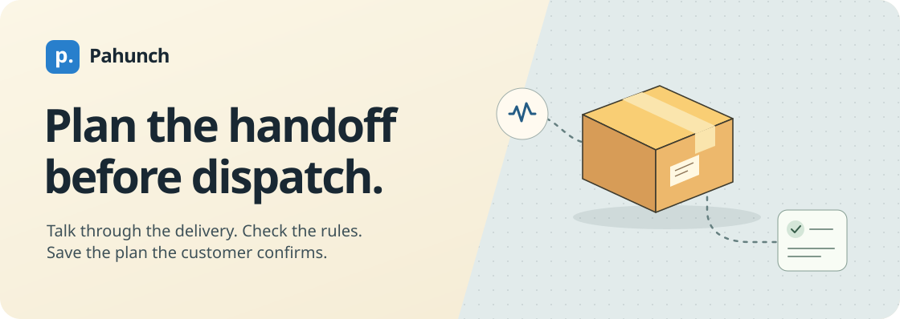
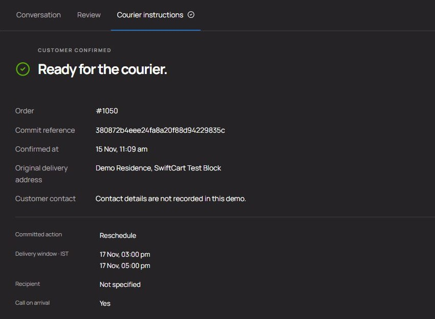
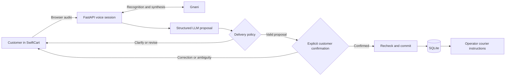

# Pahunch



**A browser voice prototype for coordinating deliveries before the parcel leaves.** The customer works out a time or an eligible recipient, the backend checks the delivery rules, and the operator sees the confirmed instructions.

[See the browser demo flow](#the-experience) · [Explore the implementation](#how-it-works) · [Run locally](#run-locally-on-windows)

> I ordered a phone while I was out of town. My address was right, but who would be there to receive it? That question became Pahunch, a portfolio prototype built for Gnani AI’s Great Indian AI Internship Challenge.

## The experience



*Saved courier instructions in the operator console, captured from a local demo order.*

| 01 · Listen | 02 · Validate | 03 · Save |
| :--- | :--- | :--- |
| The customer accepts an incoming call in **SwiftCart** and discusses the handoff. | The backend checks the requested time, recipient and delivery rules. | After explicit agreement, the **Pahunch console** displays the saved instructions. |

<details>
<summary><strong>Walk through the two-tab demo</strong></summary>


Once the application is running:

1. Open **SwiftCart** at `/shop`, place a demo order, and leave its order page open.
2. Open `/dashboard` in a second tab on the **same address**. Select the same order and unlock operator controls with your local `OPERATOR_API_TOKEN`. The operator key is separate from the order reference.
3. Choose **Call customer** before dispatch. Accept the incoming call in SwiftCart, allow microphone access, and wait for the assistant’s introduction.
4. Request a delivery time and explicitly confirm the final proposal. For an eligible neighbour handoff, supply the neighbour’s name and a usable location. Order rules may require direct handoff instead.
5. Open **Courier instructions** in the console to inspect the saved result. Choose **Mark out for delivery** when the parcel actually leaves.

The console is where courier instructions are viewed in this prototype. The order’s original address is retained; an authorized neighbour’s location belongs to the handoff instructions. Where OTP verification applies, the courier verifies with the customer. The assistant does not collect the code.

</details>

## How it works



| Layer | Implementation |
| --- | --- |
| Browser | React, TypeScript and Vite; the [voice controller](frontend/src/voice/controller.ts) owns microphone and playback behavior. |
| Voice session | FastAPI [realtime handling](backend/app/realtime.py), Gnani speech recognition and synthesis, and streaming transcription support. |
| Conversation | The [planner](backend/app/planner.py) interprets requests and constructs proposals using recorded order details and availability. Gemini, OpenRouter, Groq and Ollama are configurable planner providers. |
| Delivery rules | [Policy validation](backend/app/policy.py) checks availability, payment and value restrictions, recipient permissions, and required location details. Cash-on-delivery orders and orders valued at ₹25,000 or above require direct customer handoff. |
| Saved handoff | [Call service](backend/app/calls.py) verifies consent and current policy before saving a delivery commit and courier card in SQLite. |

### A small phrase with a large consequence

“That works if you change it” includes agreement **and** a request for revision. Treating it as a yes could save instructions the customer never accepted.

The [explicit confirmation gate](backend/app/consent.py) checks the complete utterance. These examples are covered by the [conversation regression tests](backend/tests/test_confirmation_conversation.py):

```python
is_explicit_confirmation("that works for me")          # True
is_explicit_confirmation("आगे बढ़ाइए।")                # True
is_explicit_confirmation("that works if you change it") # False
is_explicit_confirmation("He said go ahead")            # False
```

That gate is one part of the save path. `CallService.commit_plan` also checks confirmation against the current proposal, revalidates delivery policy, and uses an idempotency key so a repeated save can return the existing commit. The same regression suite follows a high-value order through a rejected third-party handoff, a valid reschedule, explicit agreement, and a single saved commit.

## Run locally on Windows

Use **Command Prompt**, starting in this repository’s root. Prerequisites: Python **3.11+**, [uv](https://docs.astral.sh/uv/), and Node.js **22.12+**. If your terminal shows a WSL path such as `/mnt/c/...`, open CMD with `cmd.exe /d` first.

### 1. Configure the backend

```bat
cd backend
uv sync --locked
if not exist .env copy .env.example .env
notepad .env
```

Keep credentials in `backend/.env`. The [environment template](backend/.env.example) lists the settings.

| Setting | Local browser demo |
| --- | --- |
| `GNANI_API_KEY` | Your speech recognition and synthesis credential. |
| `LLM_PROVIDER` | Defaults to `gemini`; set the credential for the selected provider only. |
| `GEMINI_API_KEY` | Required when using the default Gemini planner. |
| `LLM_MODEL`, `LLM_BASE_URL` | Optional overrides for provider defaults. |
| `OPERATOR_API_TOKEN` | A long random value you choose for operator controls. |
| `TELEPHONY_PROVIDER` | Keep `none` for calls between browser tabs. |

### 2. Build and start

From `backend`, continue in the same CMD window:

```bat
cd ..\frontend
npm.cmd ci
npm.cmd run build -- --configLoader runner
cd ..\backend
.venv\Scripts\python.exe -m uvicorn app.main:app --host 127.0.0.1 --port 8000
```

Open the [home page](http://127.0.0.1:8000/), [SwiftCart](http://127.0.0.1:8000/shop), and [operator console](http://127.0.0.1:8000/dashboard). The [health endpoint](http://127.0.0.1:8000/health) reports server availability; it does not validate external providers.

Stop with **Ctrl+C**. Restart after editing `backend/.env` and rebuild after changing the frontend.

For frontend development, keep the backend on port `8000`. In a second CMD window, start from `frontend`:

```bat
npm.cmd run dev -- --port 5173 --strictPort --configLoader runner
```

Open both demo tabs on `http://127.0.0.1:5173`. Vite forwards API and WebSocket traffic to the backend.

## Checks and status

Run backend tests from `backend`:

```bat
uv run pytest
```

Run frontend tests and a production build from `frontend`:

```bat
npm.cmd test -- --configLoader runner
npm.cmd run build -- --configLoader runner
```

For browser checks, install Chromium once with `npx.cmd playwright install chromium`. Keep the frontend development server above running on port `5173`, then run `npm.cmd run test:e2e` in another CMD window from `frontend`. The [Playwright configuration](frontend/playwright.config.ts) covers desktop, mobile and tablet viewports.

Automated tests exercise policy, conversation and browser behavior using test fixtures and simulated services. They do not establish live provider reliability, microphone quality, or production readiness. Real handset behavior and live speech latency still need end-to-end validation. The optional [Twilio adapter](backend/app/telephony.py) has separate verification and approval gates; the main demonstration uses browser calls.

### Media

The project also has an animated introduction and a separate recorded delivery demo, stored outside this repository. The recorded browser demo uses scripted conversation turns. They illustrate the idea and workflow; the local application and tests are the inspectable implementation.

Released under the [MIT License](LICENSE).
